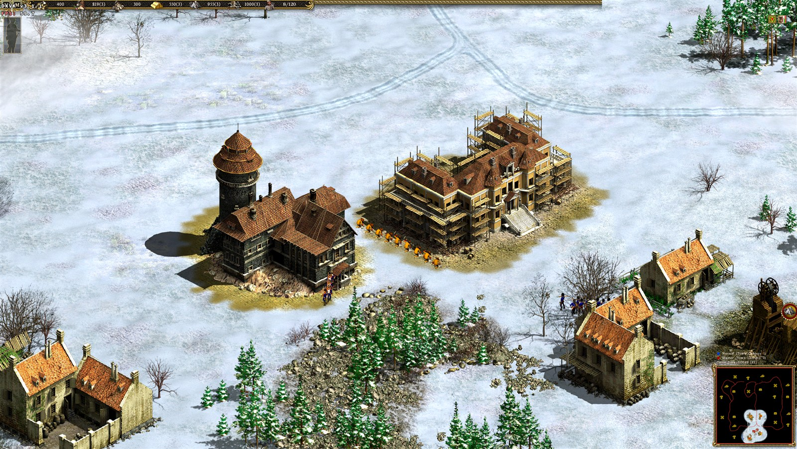

# Cossacks II — Unofficial Restoration

[Русский](README-RU.md) · [Download v0.1.1-preview](https://github.com/Klopi746/cossacks-ii-unofficial-restoration/releases/tag/v0.1.1-preview) · [Project page](https://susmers.com/cossacks-ii-restoration/) · [Verification](docs/VERIFICATION.md)

A free, unofficial restoration patch for the **verified GOG Cossacks II: Battle for Europe executable**. It requires your own original game. [Buy Cossacks II Anthology on GOG](https://www.gog.com/en/game/cossacks_ii_anthology).

**This is a preview.** A user successfully ran a short diagnostic session through the 0.1.0 C# launcher. Version 0.1.1 fixes maintenance and file-safety problems; it uses the same patched game EXE, DXVK and DxWnd. Long battles, save/load compatibility and other hardware still need testing. [Changes in this release](CHANGELOG.md).

*User-provided screenshot, 23 October 2026. About 59.7 FPS in one frame does not establish sustained performance. [Original image and rights](docs/images/README.md).*

## Install

1. Close the game and DxWnd. Keep a separate copy of the original game if you want a trial installation.
2. Download `CossacksII-Unofficial-Restoration-0.1.1-preview-setup.exe` and `SHA256SUMS.txt` from the [release page](https://github.com/Klopi746/cossacks-ii-unofficial-restoration/releases/tag/v0.1.1-preview). Compare the SHA-256 when verifying your download.
3. Open setup, choose English or Russian, select the folder containing `engine.exe`, and continue. GOG registry detection is used when available; manual selection is always available.
4. Choose the rendering resolution, confirm that you own the original game, and install. Native primary-monitor resolution is proposed; 1920×1080, 2560×1440 and 1280×720 profiles are also offered.
5. Start the game yourself using **Cossacks II — Unofficial Restoration** on the desktop. Setup never starts the game.

An existing shortcut is preserved; a numbered shortcut is created if the name is occupied. The installer uses the game's local folder and does not request administrator rights. Use a folder you can write to.

**Installation works offline.** DXVK, DxWnd 2.06.16, the required DLLs, local EXE patcher, licenses and corresponding DxWnd sources are inside setup. There is no separate component search or Python / PowerShell 7 requirement. The corresponding-source ZIP is also available as a separate release asset; see [third-party details](THIRD_PARTY.md).

## Included behavior

- The two identified formation-table consumers expand from 64 to 128 rows. Allocation sizes, strides and limits change together; bounds checks, overflow warnings and unused-row checks remain. [Patch details](docs/ENGINE_PATCH.md).
- DXVK 3.1.1 x86 handles D3D8 through the game's `X3D8.DLL` import with the matching D3D9 component. The profile limits rendering to 60 FPS and sets the tested memory/VSync compatibility options. A limit is not a promise of constant 60 FPS.
- DxWnd runs a borderless window on the primary monitor. The menu fills its area by stretching the original 4:3 layout; this is not a newly drawn widescreen menu. Physical Windows display modes are not changed by our launcher.
- Originals are backed up before replacement. Every owned file has before/after hashes and a transaction record in `.c2-restoration/state.json`.
- Normal launch temporarily makes only `log.txt` read-only, preserving the quiet-log fallback. The launcher restores the prior read-only bit after the game exits. A later launch or uninstall recovers an unfinished own journal. New log content, if any, is retained.
- `Restoration-Diagnostics.cmd` in the game folder starts diagnostics with a writable game log and a small DXVK FPS/version HUD. This is the right mode to check the formation fix without masking warnings.

No AI / balance mod, map pack, third-party replacement engine, game installer or ready-made `engine.exe` is included.

## Remove or recover

Close the game, open `Restoration-Uninstall.cmd` or setup again, select the same game folder, continue to the components page, and choose **Uninstall / recover**. Original files are restored from verified backups. `Save`, `Players` and unrelated files are not removed.

If an owned file changed after installation, its current contents are copied to `.c2-restoration/conflicts/` before the original is restored. An edited shortcut is retained. The summary reports the conflict count. Backups, history and journals are kept for review; when maintenance runs from the installed EXE, that EXE is also retained because Windows locks it. The patch is removed once the original game files are restored, even if this recovery folder remains.

Re-running setup for an unchanged installation verifies it and makes no file changes. It refuses to overwrite later edits. To change the rendering resolution, uninstall and reinstall; the previous recovery folder is archived under `.c2-restoration-history-*`. If a backup is missing or changed, recovery stops before altering game files and explains which file needs attention. Keep your own backups until manual testing is complete.

To move from 0.1.0 to 0.1.1, use the **new external setup** to remove/recover the old installation, then install again. Do not delete recovery folders to force an upgrade. Invalid ownership records now stop maintenance; retain the journal and backups for inspection. Foreign shortcut records cannot authorize deletion of unrelated files.

## Requirements and limits

- Target systems: Windows 11 or Windows 10 22H2, x64, with existing .NET Framework 4.8+. This preview was checked on Windows 11; other Windows configurations remain unverified. [.NET availability](https://learn.microsoft.com/en-us/dotnet/framework/get-started/system-requirements).
- A GPU and 32-bit Vulkan driver meeting the [DXVK 3.x requirements](https://github.com/doitsujin/dxvk/wiki/Driver-support), including Vulkan 1.4 and its required features. Setup does not install drivers or Vulkan. DXVK [does not officially support Windows](https://github.com/doitsujin/dxvk/wiki/Windows); this integration is a community configuration.
- About 150 MB free space for local components, verified originals, installer copy and recovery history, plus the existing game. Repeated installations and diagnostics require more space.
- The exact original hashes in [SUPPORTED.md](docs/SUPPORTED.md) are required. Napoleonic Wars, Steam, modified EXEs, other GOG builds, Windows on ARM, Wine and multiplayer are not supported by this preview.
- Installation and rollback handle spaces and Cyrillic paths. Symlinks, junctions and hard-linked files are refused. Actual legacy DxWnd launch depends on the Windows system code page or an available 8.3 short path. The launcher refuses an unrepresentable path; use an ASCII-only folder in that case. Gameplay from Unicode paths is unverified.
- Setup is unsigned. Do not disable Windows protection or add antivirus exclusions for it. Build from the published sources if you need to inspect or reproduce it.

Continue manual testing with `Restoration-Diagnostics.cmd`: menu and clicks → skirmish / barracks / formation → a longer battle, roads and village capture → save, exit, relaunch and load → Alt+Tab and normal exit. Check that the writable `log.txt` gains ordinary entries without repeated `no>=MaxOf` warnings. Every nation, long battles, sustained performance and save compatibility remain manual acceptance items.

## Source and licenses

[Build instructions](docs/BUILD.md) include the pinned compiler and DXVK inputs, deterministic output, optional offline tests and CI behavior. The public source tree does not contain game data or private diagnostic evidence. [Engine patch design](docs/ENGINE_PATCH.md) explains how original instruction bytes are read locally instead of embedded in the package.

Our independent code and recipe use [MIT](LICENSE). DXVK uses [zlib](licenses/DXVK-LICENSE.txt); DxWnd and Disassembler use GPL-3.0-or-later, with their corresponding sources supplied. Game artwork, screenshots and trademarks are outside our MIT grant. Each component retains its own rights; [THIRD_PARTY.md](THIRD_PARTY.md) records provenance and licensing boundaries. This free project is unofficial and unaffiliated with GSC Game World or GOG.
